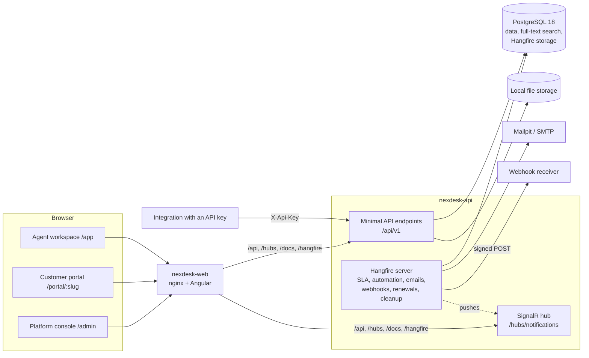
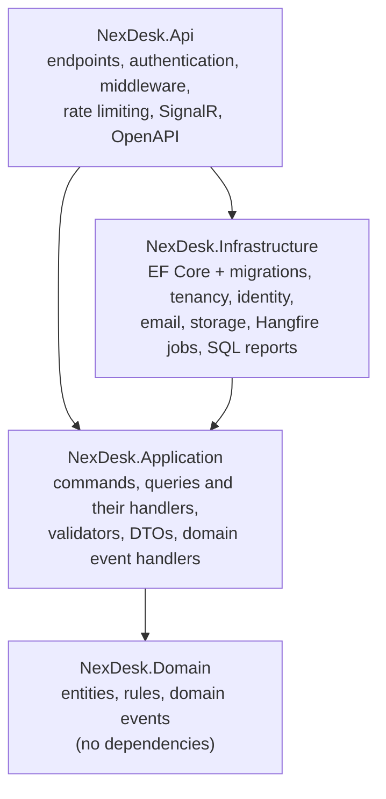
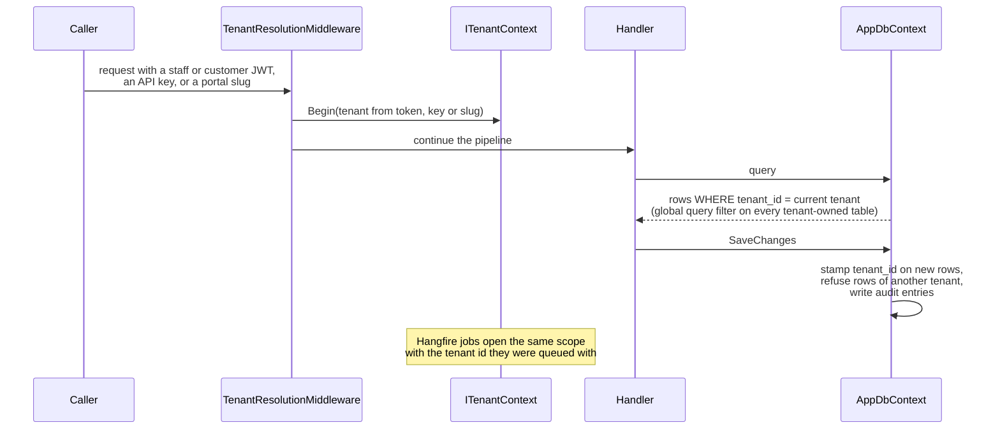
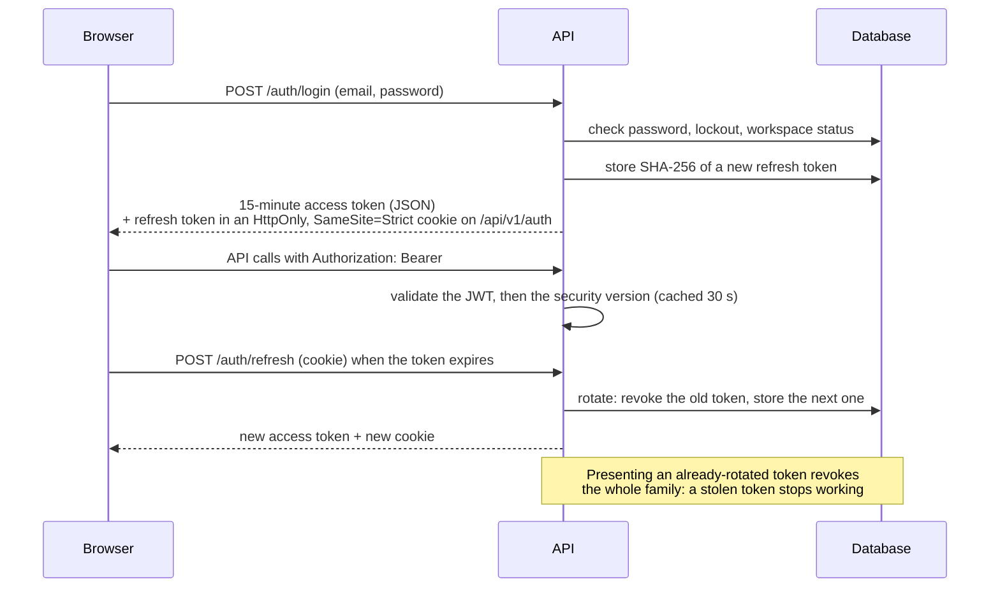
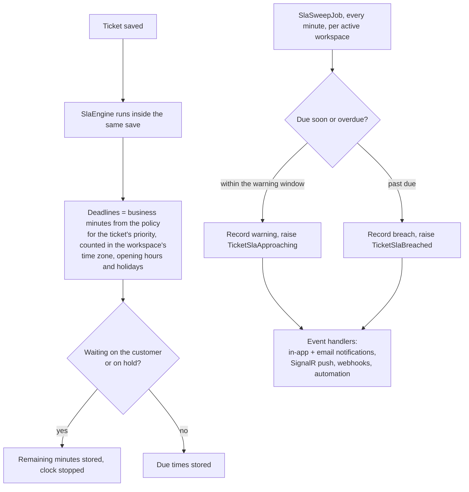
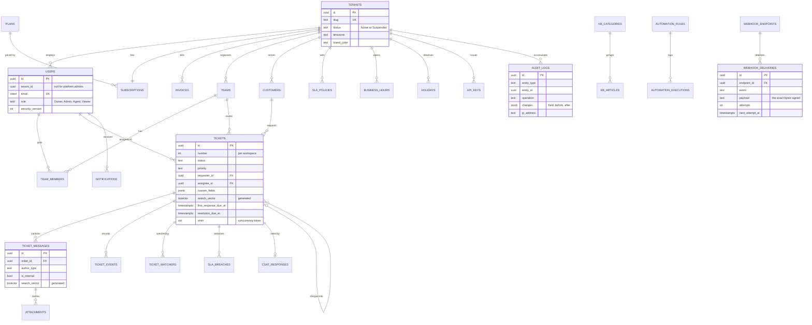
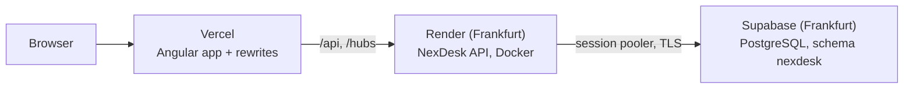

# NexDesk API

**NexDesk** is a multi-tenant help desk and SLA management SaaS. Companies sign up for their own
isolated workspace, invite their support team, and handle customer requests with SLA timers, automation
rules, a knowledge base, real-time notifications and reports. Their customers use a branded help centre;
the people who run NexDesk use a platform console.

This repository is the backend: an ASP.NET Core API on .NET 10 with PostgreSQL. The Angular client lives
in [nexdesk-web](https://github.com/mahmoudadel810/nexdesk-web), and the Flutter app for support teams in
[nexdesk-mobile](https://github.com/mahmoudadel810/nexdesk-mobile).


## Features

- **Workspaces and people:** self-service sign-up with email confirmation, a setup wizard, invitations,
  owner/admin/agent/viewer roles with permission-based authorisation, teams and agent availability.
- **Tickets:** statuses, priorities, types, tags, per-workspace custom fields (JSONB), public replies and
  internal notes, attachments, @mentions, watchers, an activity timeline, merging, bulk actions, saved
  views, full-text search and optimistic concurrency.
- **SLA engine:** first-response and resolution targets per priority, counted in business hours and holidays
  in the workspace's time zone, with a paused clock while waiting on the customer, countdowns, warnings,
  breach records and escalation notices.
- **Automation:** rules triggered by new tickets, updates or time ("pending for 48 hours") with AND/OR
  conditions and actions, loop protection and an execution log.
- **Customer portal:** per-workspace customer accounts, branded help centre, requests, replies,
  satisfaction ratings, article suggestions while typing, and email-to-ticket through an inbound webhook.
- **Knowledge base:** categories, Markdown articles with drafts, public search and "was this helpful?".
- **Notifications:** an in-app centre over SignalR, emails, and per-person preferences.
- **Billing (simulated):** Free, Pro and Business plans with limits enforced by the API, checkout that
  issues paid invoices with PDFs, monthly renewals, usage meters and per-plan rate limits.
- **Reports:** volume, backlog, response times, SLA compliance, CSAT and an agent leaderboard, computed in
  SQL, with CSV export.
- **Developer platform:** scoped, hashed API keys for a public API, and signed outbound webhooks with
  retries, a delivery log and resend.
- **Audit log:** who changed what, each field before and after, when and from which address.
- **Platform console:** every workspace with its plan and usage, suspension, revenue and sign-up charts,
  and a guarded Hangfire dashboard.

## Quick start

Prerequisites: Docker. The .NET 10 SDK is only needed to run the API or tests outside containers.

```bash
cp .env.example .env
# Replace JWT_SIGNING_KEY (32+ characters, e.g. `openssl rand -base64 48`), INBOUND_SECRET (16+)
# and PLATFORM_ADMIN_PASSWORD (12+) in .env.
docker compose up -d --build
docker compose run --rm api --seed
```

The API applies its migrations on startup. `--seed` fills the database with the demo below and exits;
it refuses to run outside the Development environment unless given `--force`, and running it again
changes nothing. Then start the web client (see [nexdesk-web](https://github.com/mahmoudadel810/nexdesk-web#quick-start))
and open http://localhost:4200.

| Service | URL |
|---------|-----|
| API | http://localhost:8080 |
| API reference (Scalar) | http://localhost:8080/docs |
| OpenAPI document | http://localhost:8080/openapi/v1.json |
| Liveness / readiness | http://localhost:8080/health/live, http://localhost:8080/health/ready |
| Mailpit inbox (every email the API sends) | http://localhost:8025 |
| Background jobs (platform admin only) | opened from the platform console |

### Demo accounts

Every demo account uses the password **`NexDesk-demo-2026`**.

| Who | Sign in as | Where |
|-----|-----------|-------|
| Platform admin | `admin@nexdesk.demo` | `/auth/login`, lands on `/admin` |
| Workspace owner (BrightPath, English, Business plan) | `sarah@brightpath.demo` | `/auth/login` |
| Admin | `daniel@brightpath.demo` | `/auth/login` |
| Agent | `maya@brightpath.demo` (also `tom@`, `priya@`, `leo@`) | `/auth/login` |
| Viewer | `finance@brightpath.demo` | `/auth/login` |
| Customer | `casey@customers.demo` | `/portal/brightpath/login` |
| Arabic workspace owner (Souqna, Pro plan) | `layla@souqna.demo` | `/auth/login` |
| Arabic workspace customer | `ahmed@customers.demo` | `/portal/souqna/login` |

The seeder replays about four months of history for both workspaces through the real domain code with
its clock moved to each moment: around 430 tickets across every status, replies and internal notes, SLA
deadlines that were met or breached, ratings, plan changes with monthly invoices, knowledge base articles,
automation rules and notifications. Eight smaller workspaces give the platform console its history.

### A bigger dataset: thirty Saudi companies

```bash
docker compose run --rm api --seed=medium
```

`--seed=medium` adds thirty made-up Saudi companies to the demo above (running it on an already seeded
database only adds what is missing). They span ten industries (online stores, telecom, food delivery,
clinics, training, logistics, digital payments, travel, property management and car rental), and about
seven in ten work in Arabic. Each one has 60 to 180 days of history:

- staff and customers with Saudi names, teams, a Sunday to Thursday week in `Asia/Riyadh` and the Saudi
  public holidays that fall inside its history (Eid al-Adha, Arafat Day, National Day);
- tickets that carry a city, a `+966 5x` mobile number, an industry reference (order, booking, contract,
  medical file...) and amounts in SAR, as conversations, internal notes that @mention teammates,
  ratings and SLA breaches;
- custom fields, knowledge base articles, automation rules, plan changes and invoices, an API key,
  a paused webhook with a delivery history, saved views and a pending invitation.

Together that is about 5,400 tickets, 19,000 messages and 1,900 customers, roughly 55 MB. The companies
are generated from a fixed seed, so every run produces the same names. Some owners to sign in as, all
with the demo password:

| Workspace | Language | Owner |
|-----------|----------|-------|
| خزامى للاتصالات (telecom) | Arabic | `alanoud.sulami@khuzama-telecom.demo` |
| طويق العقارية (property) | Arabic | `nawaf.buqami@tuwaiq-properties.demo` |
| Waha Car Rental | English | `haifa.subaie@waha-cars.demo` |
| Zumurrud Travel | English | `yazeed.buqami@zumurrud-travel.demo` |

### Running the API from source

```bash
docker compose up -d postgres mailpit
cp src/NexDesk.Api/appsettings.Development.example.json src/NexDesk.Api/appsettings.Development.json
dotnet run --project src/NexDesk.Api
dotnet run --project src/NexDesk.Api -- --seed
```

Set the password in `appsettings.Development.json` to match `POSTGRES_PASSWORD` in `.env`, and give
`Jwt:SigningKey` a random value of at least 32 characters.

## Architecture

### System overview



### Backend layers



Commands and queries are plain records with hand-written handlers behind a small validating decorator;
there is no MediatR or AutoMapper. Handlers return `Result<T>`, and failures become RFC 7807 problem
documents with a stable `code`.

### Multi-tenancy



Only classes marked `ICrossTenantQuery` may bypass the filter (sign-up checks, the platform console, jobs
that list tenants), and an architecture test fails the build if `IgnoreQueryFilters` appears anywhere else.
Integration tests prove that one workspace can never read or change another's data on every endpoint.

### Sign-in and refresh



The mobile app (Phase 16) has no reliable cookie jar, so it uses three sibling endpoints that carry the
refresh token in the body and keep it in the phone's Keychain or Keystore. Rotation and theft detection are
the same code.

```mermaid
sequenceDiagram
    participant M as Mobile app
    participant S as Secure storage
    participant A as API
    M->>A: POST /auth/mobile/login (email, password, device name)
    A-->>M: access token (sid = sign-in id) + refresh token, no cookie
    M->>S: save the refresh token
    M->>A: POST /auth/mobile/refresh { refreshToken } (one at a time)
    A-->>M: new pair; the old token is now spent
    M->>S: save the new refresh token before using the new access token
    M->>A: POST /auth/mobile/logout { refreshToken }
    A->>A: revoke the whole sign-in
```

### SLA timers and breaches



## Data model

The main tables (`tenant_id` and audit columns are left out; every table below except `users`, `plans`
and `tenants` itself belongs to one workspace):



## Tech stack

| Area | Choice and version |
|------|--------------------|
| Runtime | .NET 10 (LTS), ASP.NET Core minimal APIs |
| Database | PostgreSQL 18, EF Core 10.0.15, Npgsql 10.0.3, snake_case naming |
| Validation | FluentValidation 12.2 |
| Background jobs | Hangfire 1.8.25 on PostgreSQL storage (Hangfire.PostgreSql 1.21.1) |
| Real time | SignalR, with tenant and user groups |
| Email | MailKit 5.0 over SMTP (Mailpit locally), HTML templates |
| PDFs | QuestPDF 2026.9 (community licence) |
| Markdown | Markdig 1.6 |
| Observability | Serilog 10 with correlation ids, OpenTelemetry 1.21 tracing, health checks |
| API docs | OpenAPI document with examples, Scalar 3.0 |
| Tests | xUnit 2.9, Shouldly 4.3, NSubstitute 6.2, Testcontainers 4.16 (real PostgreSQL) |

## Design decisions

**One database, shared schema, `tenant_id` on every row.** A database per tenant isolates harder but
multiplies migrations, connections and backups for a product whose tenants are mostly small. Isolation
here rests on three layers that do not trust each other: EF Core global query filters on every
tenant-owned entity, a `SaveChanges` interceptor that stamps and checks `tenant_id`, and integration tests
that try to reach another tenant's data through every endpoint. Indexes lead with `tenant_id`.

**Short access tokens and rotating refresh tokens.** Access tokens live 15 minutes and are kept in memory
by the client; the refresh token sits in an `HttpOnly`, `SameSite=Strict` cookie that only the refresh
endpoints receive, so scripts on the page cannot read it. Each refresh token is used once and stored only
as a hash. Reuse of a rotated token is treated as theft and revokes every token of that sign-in. A
security version in the token lets a password change or deactivation end all sessions within 30 seconds.
The mobile endpoints (`/auth/mobile/*`) return the refresh token in the body instead, for the device's
secure storage. They never read the cookie and the cookie endpoints never read a body token, so script on
the web page cannot trade the browser's cookie for a token it can read. A refresh stores the next token
before claiming the old one, so when two refreshes race, the loser's revocation also covers the winner's
token and nothing from that sign-in survives. There is no grace window for a just-rotated token: a phone
refreshes one request at a time instead.

**PostgreSQL full-text search rather than Elasticsearch.** Generated `tsvector` columns with GIN indexes
cover subjects, conversations and articles, stay consistent inside the same transaction, respect the
tenant filter for free, and need no second system to run, secure or keep in sync. A dedicated search engine
would earn its place with fuzzy matching or very large volumes; neither is needed here.

**Hangfire for background work.** It stores jobs in the same PostgreSQL database, so a job and the change
that queued it share durability without a message broker. Jobs are queued with the tenant id and reopen
the tenant scope. Webhook retries are tracked on the delivery row rather than by Hangfire, so every
attempt appears in the delivery log.

**Audit entries from the change tracker.** Domain events carry no before/after values and only tickets
raise them, so the audit log is written from EF Core's change tracker inside the same save. It can never
disagree with the data. A catalogue lists the audited records and leaves out secrets and bookkeeping.

**Hand-written handlers instead of MediatR and AutoMapper.** Both are now commercially licensed. A
40-line decorator gives validation before every handler, and explicit `From(...)` mappings keep DTOs
obvious.

## Customer portal and inbound email

Customers use the help centre of a workspace at `/portal/{slug}` in the web client. They sign up with their
own account (separate from staff, unique per workspace), follow their requests and rate them once solved.
Portal tokens use a different audience than staff tokens, so neither opens the other's endpoints.

Email-to-ticket is simulated with a webhook a mail gateway would call:

```bash
scripts/send-inbound-email.sh brightpath casey@customers.demo "Cannot sign in" "I get an error." "Casey"
scripts/send-inbound-email.sh brightpath casey@customers.demo "Re: Cannot sign in [#12]" "It works now."
```

The first call opens a ticket. The second adds a reply to ticket 12 because the subject carries its
reference and the sender is its requester; otherwise it would open a new ticket. The webhook is
`POST /api/v1/inbound/email/{slug}` and requires the `X-Inbound-Secret` header to match `INBOUND_SECRET`
from `.env`.

## Workspace settings and branding

Owners and admins set the workspace name, time zone and default language, and brand the help centre with
a logo, an accent colour and welcome text (`GET/PUT /api/v1/settings`, `POST/DELETE /api/v1/settings/logo`).
A logo must be a PNG, JPEG or WebP of up to 512 KB; its type is read from the file's first bytes, so a
script renamed to `.png` is refused. It counts toward the plan's storage and is served publicly from
`/api/v1/portal/{slug}/logo?v={timestamp}`. The address changes with every new logo, so the image is cached
for a week with `immutable`.

## Platform admin console

The platform admin runs NexDesk itself and belongs to no workspace. The API creates the account on startup
from `PLATFORM_ADMIN_EMAIL` and `PLATFORM_ADMIN_PASSWORD` in `.env` if that address has no account yet; it
never overwrites an existing one. The admin signs in on the normal sign-in page and lands on `/admin` in the
web client, which uses `/api/v1/admin/...`:

- every workspace with its plan, team size, this month's tickets and owner, searchable and filterable
- a read-only overview of one workspace: usage against plan limits, totals, admins and recent invoices. It
  never shows ticket or customer content, and there is no way to act as the workspace
- suspending and reactivating a workspace. Suspension takes effect on the team's, customers' and API keys'
  next request, nothing is deleted, and the workspace's audit log shows the change as made by NexDesk
- monthly recurring revenue now and by plan, revenue under contract at each month's end (from paid
  invoices), and sign-ups per month

The Hangfire dashboard is at `/hangfire` and opens only through a single-use link the console asks the API
for (`POST /api/v1/admin/jobs-dashboard`). The link works once within a minute and becomes an HttpOnly
session cookie that is sent only to `/hangfire`.

## Public API, webhooks and the audit log

Workspaces on a plan with API access (Business) can issue API keys under Developers. A key is shown once,
stored only as a SHA-256 hash, and holds the `tickets:read` and/or `tickets:write` scope. Integrations call
the public API with it:

```bash
curl -H "X-Api-Key: ndk_..." "http://localhost:8080/api/v1/public/tickets?search=refund"
curl -X POST -H "X-Api-Key: ndk_..." -H "Content-Type: application/json" \
  -d '{"subject":"Order 1001 arrived damaged","description":"The box was crushed.","requesterEmail":"casey@customers.demo"}' \
  http://localhost:8080/api/v1/public/tickets
```

Each key gets the plan's requests-per-minute allowance. Tickets it opens use the API channel, and the
key's name shows as the actor in the ticket timeline and the audit log.

Webhook endpoints receive `ticket.created`, `ticket.updated`, `ticket.assigned`, `ticket.replied` and
`ticket.solved` as JSON POSTs. Every request is signed:

```
X-NexDesk-Event: ticket.created
X-NexDesk-Delivery: <delivery id>
X-NexDesk-Timestamp: 1700000000
X-NexDesk-Signature: t=1700000000,v1=<hex HMAC-SHA256 of "1700000000.<raw body>" with the endpoint secret>
```

A receiver recomputes the HMAC over the timestamp, a dot and the raw body, compares it in constant time,
and rejects old timestamps to stop replays. A delivery that fails (no 2xx answer within 10 seconds) is
retried after 1 minute, 5 minutes, 30 minutes, 2 hours and 6 hours, then marked failed. Each attempt
shows in the delivery log, and any delivery can be resent. Webhooks refuse private, loopback and
link-local addresses so a workspace cannot reach internal services; set
`WEBHOOKS_ALLOW_PRIVATE_NETWORKS=true` in `.env` to try them against a receiver on your machine.

The audit log records every create, change and delete of workspace records: who did it (a person, an API
key, the system or the platform), each field's value before and after, when, and from which address.
Secrets such as password and key hashes are never copied into it.

## Switches for demos and load tests

| Setting (environment variable) | Default | What it does |
|--------------------------------|---------|--------------|
| `RateLimiting__Enabled` (`RATE_LIMITING_ENABLED` in `.env`) | `true` | `false` turns off every request limit: per address, per member and API key by plan, and sign-in attempts. For long E2E runs and load tests; leave it on anywhere the public can reach. |
| `RateLimiting__AuthPerMinute` (`AUTH_RATE_LIMIT_PER_MINUTE`) | `10` | Sign-in, sign-up and password requests per minute from one address. |
| `Email__LogOnly` | `false` | `true` logs each email's kind and the recipient's domain instead of sending it, for hosts without a mail server. |
| `Push__Provider` | `Log` | Phone pushes for the mobile app. `Log` writes one line per push; `Fcm` sends through Firebase Cloud Messaging and needs `Push__Fcm__ProjectId` and `Push__Fcm__ServiceAccountJson`. Pushes carry the event, ticket number and subject, never the text of a reply or note, and only reach phones whose sign-in is still valid. |

## Hosted demo: Supabase, Render and Vercel

The demo runs on three free tiers: PostgreSQL on **Supabase**, the API as a Docker service on **Render**,
and the web app on **Vercel**, which forwards `/api`, `/hubs`, `/docs`, `/openapi` and `/hangfire` to
Render so the browser only ever talks to one origin (cookies stay first-party). Vercel cannot run the API
itself: it needs a long-running process for SignalR and the background jobs.



1. **Database.** Create a Supabase project, then a login role for the API that owns its own schema, kept
   out of Supabase's public data API:

   ```sql
   create role nexdesk login password '...';
   grant nexdesk to postgres;
   grant create, connect, temporary on database postgres to nexdesk;
   create schema nexdesk authorization nexdesk;
   create extension if not exists citext with schema nexdesk;
   alter role nexdesk set search_path = nexdesk;
   ```

   Connect through the session pooler, which has an IPv4 address (the direct host is IPv6 only):
   `Host=aws-1-<region>.pooler.supabase.com;Port=5432;Database=postgres;Username=nexdesk.<project-ref>;Password=...;SSL Mode=Require;Maximum Pool Size=12`.
   The API applies its migrations on first start. To load demo data, seed a local database with
   `--seed=medium`, rename its `public` schema to `nexdesk`, and copy it across with
   `pg_dump -n nexdesk --no-owner --no-privileges | psql "<pooler connection>"`.
2. **API.** In Render choose *New > Blueprint* and pick this repository; [`render.yaml`](render.yaml)
   describes the service (Frankfurt, free plan, health check, generated JWT and inbound secrets, email in
   log-only mode, rate limiting off). Paste the connection string into `ConnectionStrings__Postgres`.
3. **Web app.** Deploy [nexdesk-web](https://github.com/mahmoudadel810/nexdesk-web#hosting-on-vercel) to
   Vercel; its `vercel.json` points the rewrites at `https://nexdesk-api.onrender.com`.

Free-tier limits to know: the Render service sleeps after 15 idle minutes and takes about a minute to
wake; its disk is wiped on every deploy, so uploaded attachments and logos do not survive; live updates
use server-sent events or long polling because Vercel rewrites do not carry WebSockets.

## Tests

The integration tests start a throwaway PostgreSQL container, so Docker must be running.

```bash
dotnet test tests/NexDesk.UnitTests          # domain rules, business-hours maths, rules engine, signing
dotnet test tests/NexDesk.IntegrationTests   # every endpoint over real PostgreSQL, migrations included
dotnet format --verify-no-changes
```

`scripts/verify.sh` runs the whole set (build with warnings as errors, both test projects and the format
check) and stops at the first failure; every branch passes it before it is merged. The integration tests
include tenant-isolation tests for each tenant-scoped endpoint and a run of the demo seeder. The
browser-level Playwright suite lives in [nexdesk-web](https://github.com/mahmoudadel810/nexdesk-web#tests).

[docs/PLAN.md](docs/PLAN.md) records the domain model, API surface and cross-cutting decisions the project
was built from.
