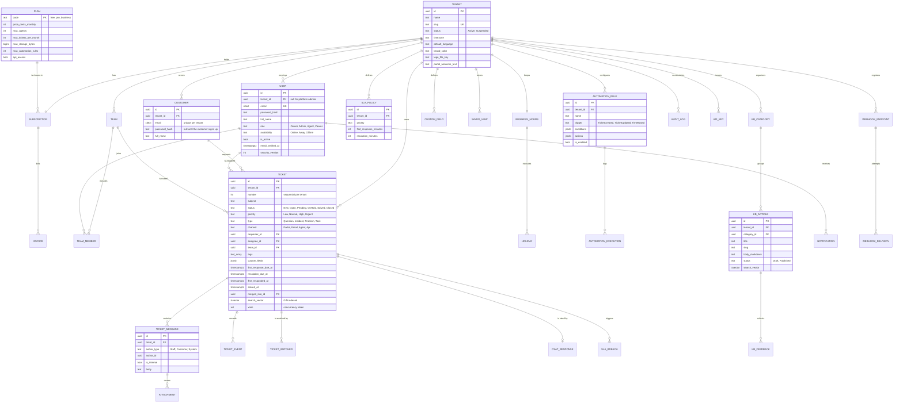

# NexDesk — implementation plan

This document fixes the domain model, the main tables and the API surface before feature work
starts. It also records the cross-cutting decisions that are expensive to change later.

## 1. Cross-cutting decisions

### 1.1 Multi-tenancy

- One shared database. Every tenant-owned table has a non-null `tenant_id` with an index that
  leads with it.
- Tenant-owned entities implement `ITenantOwned`. `AppDbContext` adds a global query filter
  `e.TenantId == _tenant.TenantId` to each of them by convention, so a new entity cannot forget it.
- `ITenantContext` is a scoped service. It is filled from exactly one of these sources:

  | Caller | Source of the tenant |
  |--------|----------------------|
  | Staff or customer request | `tenant_id` claim in the JWT |
  | Public API request | the tenant that owns the API key |
  | Portal sign-up/login, inbound email webhook, public KB | `{tenantSlug}` route value, resolved once |
  | Hangfire job | `tenantId` job argument, applied with `ITenantScopeFactory.Begin(tenantId)` |
  | Tenant sign-up, platform admin, cross-tenant jobs | no tenant — see below |

- Code that must cross tenants (sign-up uniqueness checks, the SLA sweep that enumerates tenants,
  the platform console) calls `IgnoreQueryFilters()` only inside classes marked
  `ICrossTenantQuery`. An architecture test fails the build if `IgnoreQueryFilters` appears
  anywhere else.
- A `SaveChanges` interceptor stamps `TenantId` on inserts and throws if a tracked entity carries
  a different tenant than the current context. With no tenant in context, writing a tenant-owned
  entity throws unless an explicit scope was opened.
- A suspended tenant is rejected by middleware with `403` and problem type `tenant-suspended`.

### 1.2 Identity and tokens

- Two separate identity types, each in its own table with its own token audience:
  - `users` — staff. Email is unique **globally**; a staff user belongs to one tenant. Platform
    super-admins are staff rows with `tenant_id = null` and `is_platform_admin = true`.
  - `customers` — portal users. Email is unique **per tenant**.
- Passwords are hashed with ASP.NET Core Identity's `PasswordHasher<T>` (PBKDF2). We use a custom
  user store rather than full Identity, because Identity's schema assumes one user table and one
  uniqueness rule.
- Access token: JWT, 15 minutes, audience `nexdesk-staff` or `nexdesk-portal`. Claims: `sub`,
  `tenant_id`, `role`, `perm` (one per permission), `sv` (security version).
- Refresh token: 256-bit random value, returned once, stored as a SHA-256 hash. Each use rotates
  it. Tokens form a family; presenting an already-rotated token revokes the whole family
  (reuse detection). Deactivating a user or changing a password bumps `security_version`, which
  invalidates outstanding access tokens.
- One-time tokens (email verification, password reset, invitation) are random values stored
  hashed with a purpose, an expiry and a consumed timestamp.

### 1.3 Authorization

Permissions are constants (`tickets.view`, `tickets.reply`, `users.manage`, `billing.manage`, …).
Roles map to permission sets in code:

| Role | Summary |
|------|---------|
| Owner | everything, including billing and deleting the workspace |
| Admin | everything except billing ownership |
| Agent | work tickets, read KB and reports, manage own profile |
| Viewer | read-only |

Each endpoint declares `RequirePermission(...)`. The frontend receives the permission list in the
session payload and hides actions accordingly; the backend remains the enforcement point.

### 1.4 Application layer

- No MediatR. Each use case is a `record` command/query plus a handler class implementing
  `ICommandHandler<TCommand, TResult>` or `IQueryHandler<TQuery, TResult>`.
- A decorator pipeline (registered with plain DI) runs FluentValidation, then the handler.
- Handlers return `Result<T>`; endpoints translate failures to RFC 7807 problem details with
  stable `type` slugs (`validation`, `not-found`, `conflict`, `plan-limit-reached`, …).
- Mapping is manual (`ToDto()` extension methods).

### 1.5 Domain events

Entities raise domain events (`TicketCreated`, `TicketAssigned`, `ReplyAdded`, `TicketSolved`, …).
After a successful `SaveChanges`, a dispatcher hands them to in-process handlers. Notifications,
real-time pushes, automation rules, outbound webhooks and the audit log are all handlers on these
events — none of them is called directly from ticket code. Work that can fail independently
(email, webhook delivery) is enqueued as a Hangfire job from the handler.

### 1.6 Auditing, soft delete, concurrency

- `AuditableEntity` carries `created_at/by` and `updated_at/by`, filled by an interceptor.
- `ISoftDeletable` entities get `deleted_at/by`; deletes become updates and a query filter hides
  them.
- Tickets use the Postgres `xmin` system column as a concurrency token. The API returns it as
  `version`, requires it on updates, and answers `409 conflict` when it is stale.

### 1.7 Entitlements

`IEntitlementService` is the single place that answers "may this tenant do X?" from the tenant's
plan and current usage (`EnsureCanAddAgent`, `EnsureCanCreateTicket`, `EnsureStorageAvailable`,
`EnsureFeature(ApiAccess)`, …). Handlers call it from phase 2 onward; until phase 10 every tenant
is on an implicit unlimited plan, so adding billing does not touch the handlers again.

### 1.8 Frontend conventions

- Every user-visible string goes through Transloco with keys in both `en.json` and `ar.json`; a
  unit test fails when the key sets differ.
- Layout uses CSS logical properties (`margin-inline`, `inset-block-start`, …) so RTL needs no
  overrides.
- One signal-based store per feature; HTTP access lives in a feature `*.api.ts` service.

## 2. Domain model

Supporting tables not drawn above: `refresh_tokens`, `one_time_tokens`, `invitations`,
`notification_preferences`, `usage_counters` (tickets per month, storage bytes), `ticket_sequences`
(per-tenant ticket numbers) and Hangfire's own schema.

## 3. API surface (`/api/v1`)

All list endpoints accept `page`, `pageSize`, `sort` and feature-specific filters, and return
`{ items, page, pageSize, totalCount }`.

| Area | Endpoints |
|------|-----------|
| Auth (staff) | `POST /auth/register` (creates tenant + owner), `POST /auth/login`, `POST /auth/refresh`, `POST /auth/logout`, `POST /auth/verify-email`, `POST /auth/resend-verification`, `POST /auth/forgot-password`, `POST /auth/reset-password`, `GET /auth/me` |
| Onboarding | `GET/PUT /onboarding`, `POST /onboarding/complete` |
| Users | `GET /users`, `GET /users/{id}`, `PUT /users/{id}/role`, `POST /users/{id}/deactivate`, `POST /users/{id}/reactivate`, `PUT /users/me/availability`, `PUT /users/me/profile` |
| Invitations | `GET/POST /invitations`, `DELETE /invitations/{id}`, `POST /invitations/{id}/resend`, `GET /invitations/lookup`, `POST /invitations/accept` |
| Teams | `GET/POST /teams`, `PUT/DELETE /teams/{id}`, `PUT /teams/{id}/members` |
| Tickets | `GET/POST /tickets`, `GET/PATCH /tickets/{id}`, `POST /tickets/{id}/messages`, `GET /tickets/{id}/timeline`, `POST /tickets/{id}/attachments`, `PUT/DELETE /tickets/{id}/watchers/me`, `POST /tickets/{id}/merge`, `POST /tickets/bulk`, `GET /tickets/search` |
| Files | `GET /files/{id}` (authorised download) |
| Saved views | `GET/POST /views`, `PUT/DELETE /views/{id}` |
| Custom fields | `GET/POST /custom-fields`, `PUT/DELETE /custom-fields/{id}` |
| SLA | `GET/PUT /sla/policies`, `GET/PUT /sla/business-hours`, `GET/POST/DELETE /sla/holidays`, `GET /sla/breaches` |
| Notifications | `GET /notifications`, `POST /notifications/{id}/read`, `POST /notifications/read-all`, `GET/PUT /notifications/preferences` |
| Portal | `GET /portal/{slug}` (branding), `POST /portal/{slug}/auth/register`, `/login`, `/refresh`, `/logout`, `/verify-email`, `/forgot-password`, `/reset-password`; `GET/POST /portal/{slug}/tickets`, `GET /portal/{slug}/tickets/{id}`, `POST /portal/{slug}/tickets/{id}/replies`, `POST /portal/{slug}/tickets/{id}/csat`; `GET /portal/{slug}/kb/...` |
| Inbound email | `POST /inbound/email/{tenantSlug}` |
| Knowledge base | `GET/POST /kb/categories`, `PUT/DELETE /kb/categories/{id}`, `GET/POST /kb/articles`, `GET/PUT/DELETE /kb/articles/{id}`, `POST /kb/articles/{id}/publish`, `POST /kb/articles/{id}/unpublish` |
| Automation | `GET/POST /automation/rules`, `GET/PUT/DELETE /automation/rules/{id}`, `GET /automation/rules/{id}/executions` |
| Billing | `GET /billing/plans` (public), `GET /billing/subscription`, `GET /billing/usage`, `POST /billing/checkout`, `GET /billing/invoices`, `GET /billing/invoices/{id}/pdf` |
| Reports | `GET /reports/overview`, `/volume`, `/backlog`, `/response-times`, `/sla-compliance`, `/csat`, `/agents`, each with `from`, `to`; `GET /reports/{name}/export.csv` |
| Audit | `GET /audit-logs` |
| Developer | `GET/POST /api-keys`, `DELETE /api-keys/{id}`; `GET/POST /webhooks`, `PUT/DELETE /webhooks/{id}`, `GET /webhooks/{id}/deliveries`, `POST /webhooks/deliveries/{id}/resend` |
| Public API | `/public/v1/tickets...` authenticated by `X-Api-Key`, scoped |
| Settings | `GET/PUT /settings`, `POST /settings/logo` |
| Platform admin | `GET /admin/tenants`, `GET /admin/tenants/{id}`, `POST /admin/tenants/{id}/suspend`, `/reactivate`, `GET /admin/metrics/mrr`, `GET /admin/metrics/signups` |

Real-time: SignalR hub at `/hubs/notifications`. Connections join `tenant:{id}` and `user:{id}`
groups from their token; events are `ticketCreated`, `ticketUpdated`, `ticketAssigned`,
`replyAdded` and `notification`.

## 4. Background jobs (Hangfire, PostgreSQL storage)

| Job | Schedule | Purpose |
|-----|----------|---------|
| `SlaSweepJob` | every minute | find tickets past a deadline, record the breach, notify and escalate |
| `TimeBasedAutomationJob` | every 5 minutes | evaluate time-based rules ("pending for 48h") |
| `SendEmailJob` | on demand, retried | deliver one templated email |
| `DeliverWebhookJob` | on demand, exponential backoff | sign and POST one webhook delivery |
| `UsageMeteringJob` | hourly | reconcile usage counters with actual rows |
| `TokenCleanupJob` | daily | delete expired refresh and one-time tokens |

## 5. Testing strategy

- **Unit:** domain rules, business-hours calculator, rules engine, token service, validators.
- **Integration:** `WebApplicationFactory` over a real PostgreSQL container with migrations
  applied (never `EnsureCreated`), so every run also proves the migrations work on an empty
  database.
- **Tenant isolation:** a shared fixture seeds tenants A and B. Each tenant-scoped endpoint gets
  a test asserting that B's token receives `404` for A's resource and that A's rows are unchanged.
- **Frontend:** service, store and component tests with Vitest; Playwright smoke suite at the end.

## 6. Build order

Phases follow the order in the project brief (0–15), one or more pull requests per phase, each
paired across `nexdesk-api` and `nexdesk-web` when both are touched.
